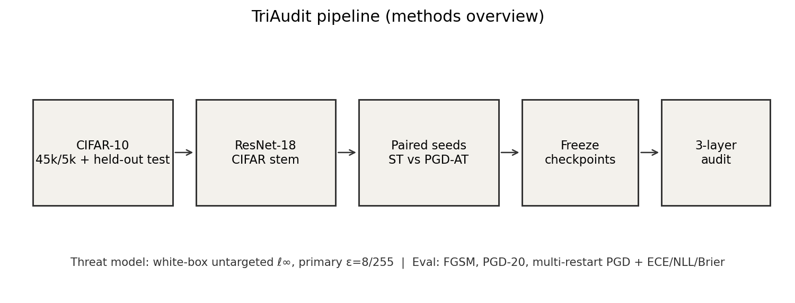
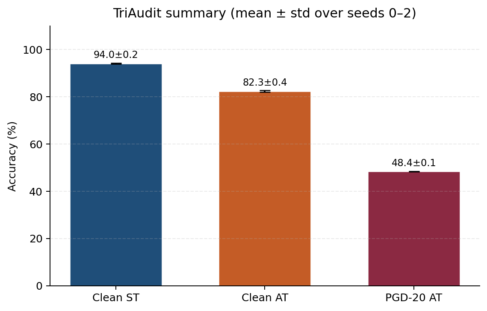
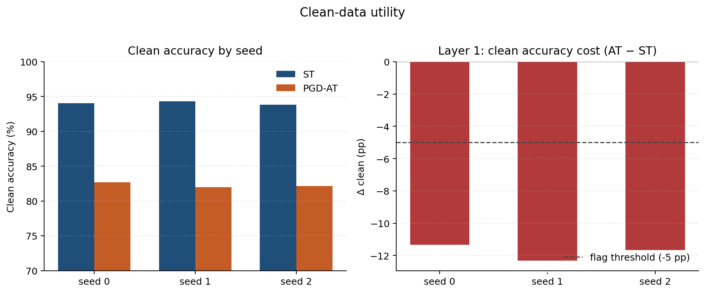
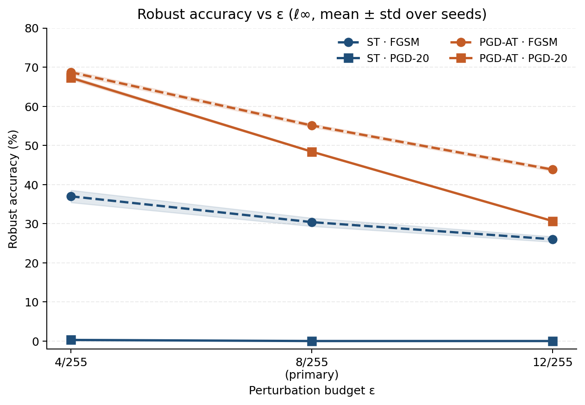
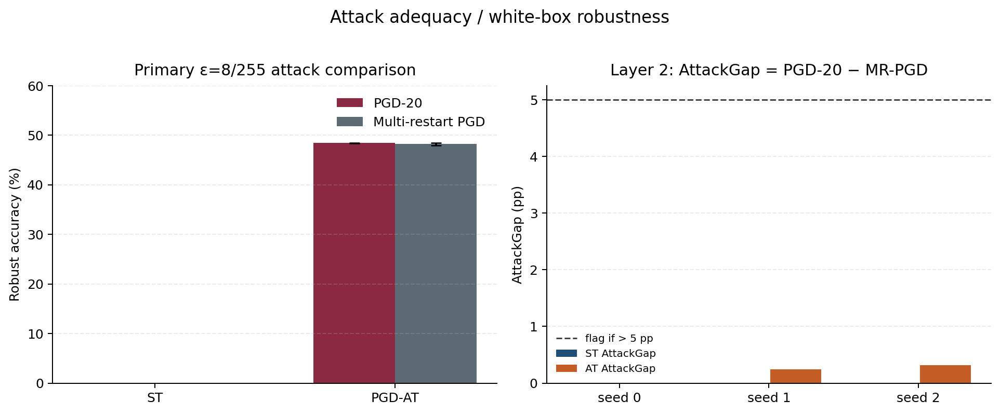
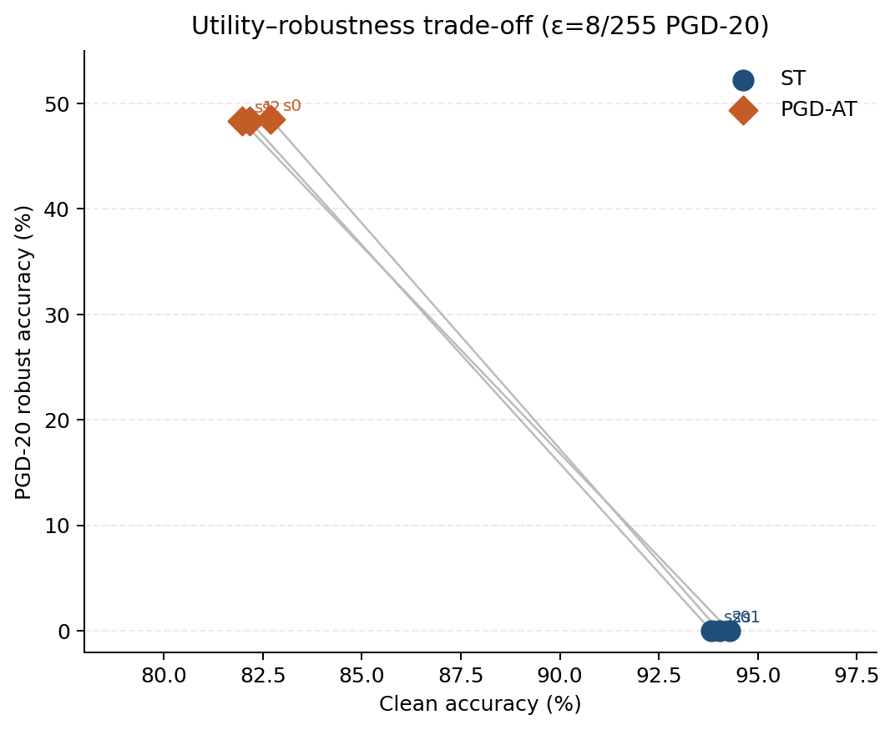
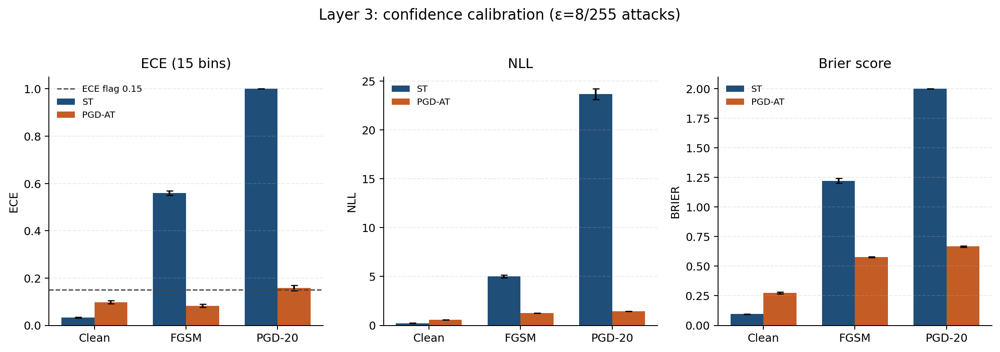
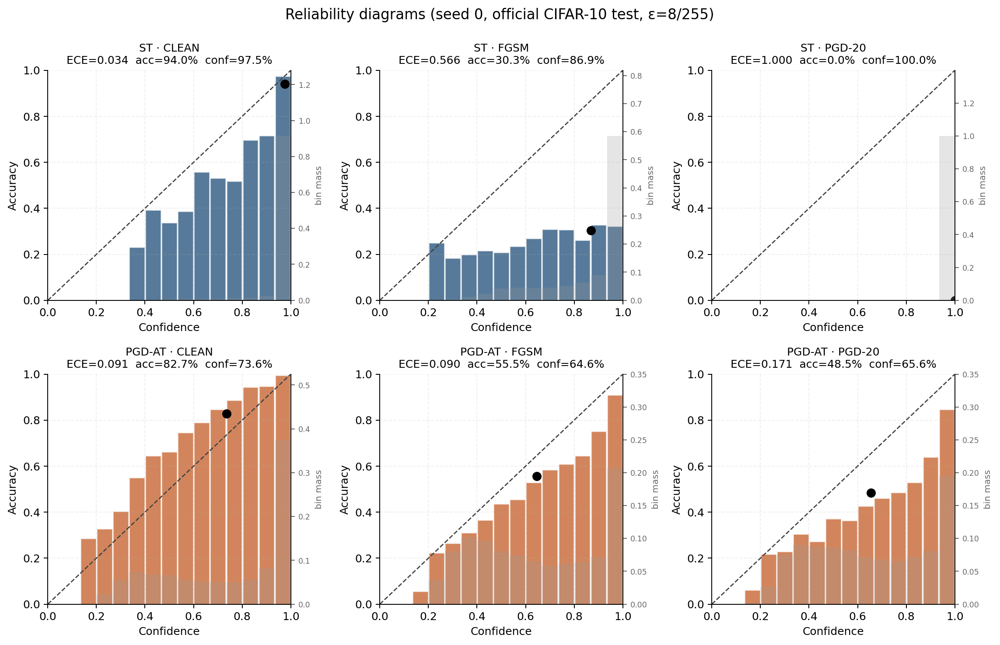
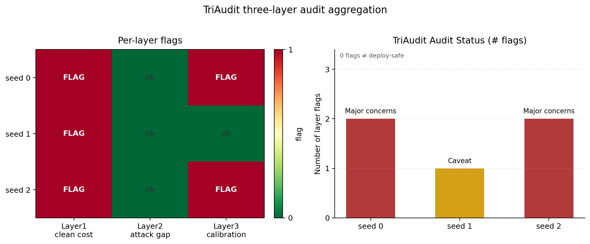

# TriAudit

**Controlled empirical audit of PGD adversarial training vs standard training on CIFAR-10**

TriAudit answers three questions at once for a seed-matched CIFAR ResNet-18 pair (ST vs PGD-AT):

| Layer | Question | Flag if |
|------:|----------|---------|
| 1 | Does AT hurt clean accuracy too much? | Δ clean &lt; −5 pp |
| 2 | Is the white-box attack evaluation adequate? | AttackGap &gt; 5 pp |
| 3 | Is confidence poorly calibrated? | any ECE &gt; 0.15 |

> This is an empirical study under a defined threat model — **not** deployment certification.  
> **Zero audit flags ≠ safe to deploy.**

**Project site:** [`docs/`](docs/) — open locally or host with GitHub Pages (`Settings → Pages → /docs`).

<p align="center">
  
</p>

<p align="center"><em>Methods pipeline — paired seeds, attacks, calibration, and audit status.</em></p>

---

## Headline results

3 seeds · mean ± std · primary ε = `8/255`

| Metric | Value |
|--------|------:|
| Clean accuracy (ST) | **94.05 ± 0.23%** |
| Clean accuracy (PGD-AT) | **82.28 ± 0.38%** |
| Δ clean (AT − ST) | **−11.77 ± 0.50 pp** |
| PGD-20 robust (AT) | **48.40 ± 0.08%** |
| AttackGap (AT) | **0.19 ± 0.16 pp** |
| ECE clean (AT) | **0.098 ± 0.007** |

**Audit status**

| Seed | Status | Drivers |
|-----:|--------|---------|
| 0 | Major concerns | clean-accuracy cost + PGD-20 ECE |
| 1 | Caveat | clean-accuracy cost |
| 2 | Major concerns | clean-accuracy cost + PGD-20 ECE |

<p align="center">
  
</p>

<p align="center"><em>Summary metrics across seeds.</em></p>

---

## What TriAudit measures

### 1. Clean utility

PGD-AT buys robustness but pays a clean-accuracy cost. Layer 1 flags when that cost exceeds **5 percentage points**.

<p align="center">
  
</p>

### 2. Robustness & attack adequacy

White-box ℓ∞ evaluation with FGSM, PGD-20, and multi-restart PGD. Layer 2 flags when PGD-20 looks much stronger than multi-restart PGD (**AttackGap &gt; 5 pp**) — a sign the attack suite may be too weak.

<p align="center">
  
</p>

<p align="center">
  
</p>

<p align="center">
  
</p>

### 3. Confidence calibration

ECE (15 equal-width bins), NLL, and multiclass Brier on **clean / FGSM / PGD-20**. Layer 3 flags if any evaluated ECE exceeds **0.15**.

<p align="center">
  
</p>

<p align="center">
  
</p>

### Audit overview

<p align="center">
  
</p>

---

## Threat model

| Item | Setting |
|------|---------|
| Dataset | CIFAR-10 (45k train / 5k val; official test held out) |
| Model | CIFAR-adapted ResNet-18 |
| Training | Seed-matched ST vs PGD-AT (shared init; seeds `{0,1,2}`) |
| Attack | White-box, untargeted, ℓ∞ |
| Primary ε | `8/255` (sensitivity at `4/255`, `12/255`) |
| AT recipe | PGD-10, ε=`8/255`, α=`2/255`, random start |

Full blueprint: [`TriAudit_Final_Project_Architecture.md`](TriAudit_Final_Project_Architecture.md)  
Research write-up: [`reports/TriAudit_research_report.md`](reports/TriAudit_research_report.md)

---

## Setup

```bash
# from repo root
python -m venv .venv && source .venv/bin/activate   # Windows: .venv\Scripts\activate
pip install -r requirements.txt
pip install -e .

# download CIFAR-10 into dataset/raw
python scripts/prepare_data.py
```

Requires Python ≥ 3.10. GPU recommended for training / full attack eval.

---

## Reproduce

Phases follow the architecture doc:

| Phase | What |
|------:|------|
| 0–1 | Architecture verify, dataset + ResNet-18 setup |
| 2–3 | ST / PGD-AT pilots |
| 4 | Paired training seeds `{0,1,2}` |
| 5–6 | Attack + calibration evaluation |
| 7–9 | Audit aggregation, stats/figures, research report |

```bash
python scripts/auto/run_phase.py --phase N
```

Regenerate figures from logged metrics:

```bash
PYTHONPATH=src python scripts/make_report_figures.py
# optional (needs GPU + local checkpoints):
PYTHONPATH=src python scripts/make_reliability_diagrams.py
```

---

## Repository layout

```text
TriAudit/
├── configs/                  # YAML experiment configs
├── dataset/splits/           # persisted 45k/5k indices
├── src/triaudit/             # data, model, train, attacks, metrics
├── scripts/                  # prepare_data, figures, auto orchestration
├── tests/
├── runs/                     # seed metrics + eval JSON (*.pt ignored)
└── reports/                  # figures, tables, research report
```

**Tracked:** code, configs, split indices, eval summaries, figures, report.  
**Not uploaded:** CIFAR-10 raw files, `*.pt` checkpoints, local ops noise.

---

## Claim boundaries

- CIFAR-10 + ResNet-18 only; white-box ℓ∞ at primary ε=`8/255`
- Alert thresholds are **project-defined**, not community standards
- Missing metrics must never be treated as passing
- Zero TriAudit flags does **not** mean a model is safe to deploy

---

## References

Related work that informed TriAudit’s focus on evaluation adequacy, clean–robust tradeoffs, and multi-axis reporting:

1. S. Bai, H. Han, R. Yang, and Y. Cao, “Adaptive spatial–frequency guidance for transferable adversarial evaluation of robust visual classifiers,” *The Visual Computer*, vol. 42, p. 449, 2026. [https://doi.org/10.1007/s00371-026-04666-w](https://doi.org/10.1007/s00371-026-04666-w)

2. R. Zhang, Y. Li, Z. Wan, J. Cao, J. Zhang, and S. Tang, “You Don’t Protect if You Don’t Expect: Breaking the Key Assumption behind CLIP’s Test Time Defenses.”

3. A. Talluri, “AUTO-ART: Structured Literature Synthesis and Automated Adversarial Robustness Testing across Evaluation Protocols, Multi-Attack Threat Models, and LLM-Driven Breaking,” arXiv:2604.20704, 2026. [https://arxiv.org/abs/2604.20704](https://arxiv.org/abs/2604.20704)

4. S. M. H. Mirsadeghi, “Active machine learning approach to adversarial training improves trade-off between natural accuracy and adversarial robustness.”

5. A. D. M. Ibrahum and J.-E. Hong, “DP2O: Dual-Pair Direct Preference Optimization for Preference-Guided Adversarial Robustness in Vision Models,” *IEEE Access*, 2026. [https://doi.org/10.1109/ACCESS.2026.3701884](https://doi.org/10.1109/ACCESS.2026.3701884)

6. M. Meymani and R. Razavi-Far, “Divided We Fall: Defending against adversarial attacks via soft-gated fractional mixture-of-experts with randomized adversarial training,” *Information Sciences*.

7. N. Bunzel, “VanillaBench: The Hidden Accuracy Cost of Adversarial Robustness,” arXiv:2607.12545, 2026. [https://arxiv.org/abs/2607.12545](https://arxiv.org/abs/2607.12545)

8. S. Saha, M. A. Pervaiz, M. S. Rahman, S. Ahmmed, and J. Maua, “Residual-guided hybrid framework for adversarially robust deep learning-based network intrusion detection,” *PLoS One*, vol. 21, no. 6, e0350737, 2026. [https://doi.org/10.1371/journal.pone.0350737](https://doi.org/10.1371/journal.pone.0350737)

---

## Key artifacts

| Artifact | Path |
|----------|------|
| Attack summary | [`runs/eval/attacks_summary.json`](runs/eval/attacks_summary.json) |
| Calibration summary | [`runs/eval/calibration_summary.json`](runs/eval/calibration_summary.json) |
| Audit status | [`runs/eval/audit_status.json`](runs/eval/audit_status.json) |
| Mean ± std table | [`reports/tables/summary_mean_std.json`](reports/tables/summary_mean_std.json) |
| Figure index | [`reports/figures/manifest.json`](reports/figures/manifest.json) |
