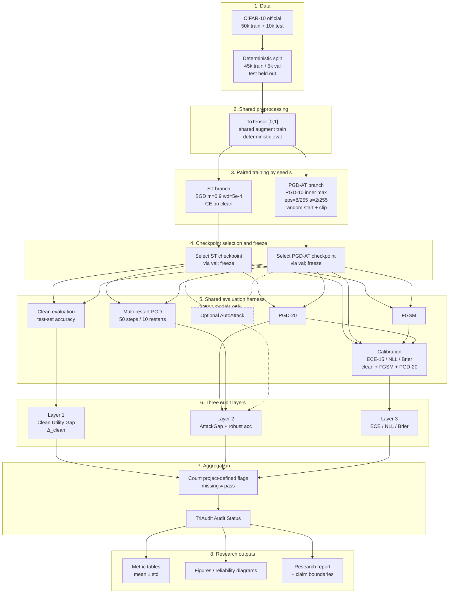

# TriAudit: Final Project Architecture

**Document type:** Implementation-ready technical blueprint  
**Project name:** TriAudit  
**Status:** Final architecture (not an exploratory method catalog)  
**Scope:** Controlled empirical audit of adversarially trained CIFAR-10 image classifiers  

---

## Document control

| Field | Value |
|---|---|
| Primary dataset | CIFAR-10 |
| Model family | CIFAR-adapted ResNet-18 |
| Training conditions | Standard Training (ST), PGD Adversarial Training (PGD-AT) |
| Primary threat model | White-box, untargeted, \(\ell_\infty\), \(\varepsilon = 8/255\) |
| Audit layers | Clean utility, attack adequacy/robustness, confidence calibration |
| Claim boundary | Empirical study under a defined threat model; **not** deployment certification |

This document is the authoritative blueprint for implementing TriAudit: data handling, model/training design, attack and calibration evaluation, audit aggregation, repository layout, milestones, literature-survey protocol, and claim limitations.

---

## 1. Project overview

### 1.1 Research question

TriAudit investigates whether **PGD adversarial training** on CIFAR-10, relative to a **seed-matched standard-trained** ResNet-18, simultaneously:

1. changes **clean-data utility** (clean accuracy cost),
2. improves **white-box adversarial robustness** under adequate attacks, and
3. alters **confidence calibration** on clean and adversarial inputs.

The study is comparative and controlled. It does **not** claim universal robustness, security certification, or deployment readiness.

### 1.2 Three empirical dimensions

| Dimension | What is measured | Why it matters |
|---|---|---|
| Clean-data utility | Clean accuracy of PGD-AT vs ST | Adversarial training often trades clean accuracy for robustness |
| White-box robustness & attack adequacy | Robust accuracy under FGSM, PGD-20, multi-restart PGD (± optional AutoAttack) | Weak attacks can overestimate robustness |
| Confidence calibration | ECE, NLL, Brier on clean / FGSM / PGD-20 inputs | Robust models may be poorly calibrated |

### 1.3 Design principles

1. **Matched comparison:** ST and PGD-AT share architecture, preprocessing, data splits, and paired seeds. The ST model for seed \(s\) is the only vanilla reference for the PGD-AT model of seed \(s\). There is **no** redundant second vanilla branch.
2. **Freeze-then-evaluate:** All attack and calibration evaluations run on **frozen** checkpoints selected after training.
3. **Attack adequacy before strong claims:** PGD-20 is a core evaluation; multi-restart PGD is required to detect under-powered attacks. AutoAttack is optional and stronger when resources allow.
4. **Project-defined alerts, not universal standards:** Thresholds in Section 3 are TriAudit operating rules for flag aggregation. They are not literature consensus criteria for “safe” models.
5. **Missing ≠ passing:** Unevaluated metrics must never be treated as green / no-flag.

### 1.4 Out of scope (core architecture)

Explicitly **excluded** from the core experiment:

| Excluded item | Rationale |
|---|---|
| EOT-PGD as a core attack | Expectation-over-Transformation is appropriate for **stochastic inference** or **stochastic defenses**. An ordinary deterministic ResNet-18 does not require EOT in the core harness. |
| Autoencoder / input-blocker defenses | TriAudit audits ST vs PGD-AT classifiers, not multi-component defense stacks. |
| Black-box transfer as primary metric | Primary threat model is white-box \(\ell_\infty\). |
| Cross-dataset generalization claims | Evaluation is CIFAR-10-centric by design. |
| Deployment / production hardening | Outside claim boundaries (Section 10). |

---

## 2. Required technical decisions

### 2.1 Dataset: CIFAR-10

| Property | Specification |
|---|---|
| Official train set | 50,000 images |
| Official test set | 10,000 images |
| Project train split | 45,000 from official train |
| Project validation split | 5,000 from official train |
| Final test set | Official 10,000 — **untouched until final evaluation** |
| Split identity | Identical indices for ST and PGD-AT |
| Classes | 10 |

**Leakage rules:**

- Validation may be used for learning-rate / early-stopping / checkpoint selection.
- The official test set must not be used for hyperparameter search or checkpoint selection.
- Record the split indices (or seed + deterministic split procedure) in experiment metadata so every run reconstructs the same 45k/5k partition.

### 2.2 Model: CIFAR-adapted ResNet-18

Use a ResNet-18 adapted to \(32 \times 32\) CIFAR images:

1. Replace the ImageNet stem (`7×7` conv, stride 2 + max-pool) with a **CIFAR stem**: typically a `3×3` convolution, stride 1, padding 1, **without** aggressive early downsampling / max-pool that would destroy spatial resolution on \(32 \times 32\) inputs.
2. Keep residual stage structure consistent with ResNet-18 depth.
3. Replace the final classifier with a **10-way** linear layer.
4. Keep architecture and preprocessing **identical** between ST and PGD-AT.

Do not change depth, width, or normalization scheme between conditions unless a documented ablation explicitly requires it (not part of the core TriAudit design).

### 2.3 Preprocessing

Shared for both training conditions:

- Convert images to tensors in **\([0, 1]\)** pixel range (attacks and clipping assume this range).
- Training augmentation (recommended baseline): random crop with padding + random horizontal flip. Document exact crop size / padding.
- Evaluation: no stochastic augmentation; deterministic resize/crop policy if any (for CIFAR-10 standard tensors, typically none beyond ToTensor).
- Channel normalization (mean/std): if used, apply **consistently** in the data pipeline **and** ensure adversarial perturbations are generated in the space the model sees (document whether attacks operate in normalized space or raw \([0,1]\) with model-side normalization). TriAudit baseline recommendation: attack in **input space after ToTensor**, with model-internal normalization as part of the forward pass, and clip adversaries to \([0,1]\) in input space before normalization.

Whatever choice is made, ST and PGD-AT must share it.

### 2.4 Training: Standard Training (ST)

| Hyperparameter | Baseline |
|---|---|
| Optimizer | SGD |
| Momentum | 0.9 |
| Weight decay | \(5 \times 10^{-4}\) |
| Initial LR | \(\approx 0.1\) (pilot starting point) |
| Batch size | Choose and document in config (common CIFAR choice: 128) |
| Epochs & LR schedule | Select during pilot; document final choice |
| Loss | Cross-entropy |

**Pilot obligation:** Run a short ST pilot to confirm the pipeline trains without NaNs / diverging loss, then lock epoch count and scheduler (e.g., multi-step decay or cosine) in config. **Do not promise a particular clean accuracy** in this architecture document; report empirical numbers only after experiments.

### 2.5 Training: PGD Adversarial Training (PGD-AT)

Inner maximization (per mini-batch example) during training:

| Parameter | Value |
|---|---|
| Attack | PGD |
| Steps | 10 (PGD-10) |
| Norm | \(\ell_\infty\) |
| \(\varepsilon\) | \(8/255\) |
| Step size \(\alpha\) | \(2/255\) |
| Random start | Enabled |
| Projection | \(\ell_\infty\) ball of radius \(\varepsilon\) around clean \(x\) |
| Pixel clip | \([0, 1]\) |

Outer minimization: same optimizer family / WD / momentum baseline as ST unless a documented pilot shows instability; prefer **matched outer hyperparameters** so the comparison isolates the adversarial objective.

Training objective (standard Madry-style): minimize cross-entropy on adversarially perturbed inputs from the inner PGD loop.

### 2.6 Seeds and pairing

- Use **paired random seeds**. Target **three seeds** if compute permits (e.g., `{0, 1, 2}` or another documented set).
- For each seed \(s\): train ST(\(s\)) and PGD-AT(\(s\)).
- ST(\(s\)) is the vanilla reference for PGD-AT(\(s\)).
- Do **not** introduce a second independent “vanilla reference” branch.

Seed everything that affects reproducibility: Python `hashseed` (if applicable), `random`, NumPy, PyTorch CPU/CUDA, DataLoader worker seeding, and cudnn determinism flags where feasible. Document residual nondeterminism (e.g., GPU atomic ops) in limitations.

### 2.7 Attack evaluation (frozen models)

Evaluate **both** frozen ST and PGD-AT checkpoints with:

| Attack | Role |
|---|---|
| FGSM | Fast baseline / weak attack |
| PGD-20 | Core iterative attack |
| Multi-restart PGD | Adequacy check; proposed start: **50 steps, 10 restarts** |
| AutoAttack | **Optional** stronger evaluation if resources permit |

**Primary threat model:**

- White-box  
- Untargeted  
- \(\ell_\infty\)  
- Primary \(\varepsilon = 8/255\)  
- Sensitivity: also evaluate at \(4/255\) and \(12/255\)

**Constraint validation (required):** for every adversarial example \(x'\), assert

\[
\|x' - x\|_\infty \le \varepsilon + \tau, \quad x' \in [0,1]^{C \times H \times W}
\]

with a small numeric tolerance \(\tau\) (e.g., \(1\mathrm{e}{-5}\)) for floating-point error. Fail the run (or quarantine results) if violations exceed tolerance.

**Why not EOT in core:** EOT averages over stochastic transformations / randomized defenses. Deterministic ResNet-18 inference does not justify EOT as a core requirement. If a future ablation adds stochasticity, revisit EOT then.

### 2.8 Calibration evaluation

Metrics:

| Metric | Spec |
|---|---|
| ECE | 15 equal-width confidence bins |
| NLL | Negative log-likelihood |
| Multiclass Brier score | Multiclass formulation |

Evaluate on:

- Clean inputs  
- FGSM inputs (\(\varepsilon = 8/255\) primary; document if sensitivity epsilons are also calibrated)  
- PGD-20 inputs  

Always report **ECE + NLL + Brier** together. ECE alone is insufficient.

---

## 3. Three audit layers

Each layer produces a **measurement** and a **project-defined flag**. Flags feed Section 4 aggregation.

### 3.1 Layer 1 — Clean Utility Gap

**Purpose:** Quantify the clean-accuracy cost (or gain) of PGD-AT relative to seed-matched ST.

**Inputs:**

- Clean accuracy of frozen PGD-AT on the official test set: \(\mathrm{CleanAcc}(\mathrm{PGD\text{-}AT})\)
- Clean accuracy of frozen ST on the same test set: \(\mathrm{CleanAcc}(\mathrm{ST})\)

**Formula:**

\[
\Delta_{\mathrm{clean}} = \mathrm{CleanAccuracy}(\mathrm{PGD\text{-}AT}) - \mathrm{CleanAccuracy}(\mathrm{ST})
\]

**Interpretation:**

- \(\Delta_{\mathrm{clean}} < 0\): PGD-AT pays a **clean-accuracy penalty** relative to ST.
- \(\Delta_{\mathrm{clean}} > 0\): PGD-AT has higher clean accuracy than ST under the tested setup (possible but not assumed).
- **Do not** take the absolute value. Sign is meaningful.

**Project-defined alert:**

\[
\Delta_{\mathrm{clean}} < -5 \text{ percentage points} \quad \Rightarrow \quad \textbf{Layer-1 flag}
\]

Compute per seed, then report mean ± std across seeds. Aggregation policy for the flag: document whether the flag triggers on the **mean** \(\Delta_{\mathrm{clean}}\) and/or on a majority of seeds; TriAudit default recommendation: flag if **mean** \(\Delta_{\mathrm{clean}} < -5\) pp, and also list per-seed flags in the appendix.

**Outputs:** \(\Delta_{\mathrm{clean}}\) (pp), per-seed table, Layer-1 flag boolean, narrative interpretation.

---

### 3.2 Layer 2 — Attack Adequacy and Robustness

**Purpose:**

1. Measure robust accuracy under white-box \(\ell_\infty\) attacks.
2. Check whether PGD-20 **overestimates** robustness relative to a stronger multi-restart PGD evaluation.

**Inputs (per model, per \(\varepsilon\)):**

- Robust accuracy under PGD-20  
- Robust accuracy under MultiRestartPGD (proposed: 50 steps, 10 restarts)  
- Optionally AutoAttack robust accuracy  

**Attack-gap formula:**

\[
\mathrm{AttackGap} = \mathrm{RobustAccuracy}(\mathrm{PGD\text{-}20}) - \mathrm{RobustAccuracy}(\mathrm{MultiRestartPGD})
\]

**Interpretation:**

- Large positive \(\mathrm{AttackGap}\): PGD-20 alone may **overestimate** robustness; attack adequacy is insufficient for strong claims.
- Near-zero gap: PGD-20 and multi-restart PGD agree more closely under the tested settings.

**Project-defined alert:**

\[
\mathrm{AttackGap} > 5 \text{ percentage points} \quad \Rightarrow \quad \textbf{Layer-2 flag}
\]

**Robustness reporting rule:** Always report robust accuracy under the **strongest completed** evaluation attack in the run (multi-restart PGD if AutoAttack not run; AutoAttack if completed). Do not claim “robustness” from FGSM alone.

**Outputs:** Robust accuracies by attack/ε, \(\mathrm{AttackGap}\), Layer-2 flag, strongest-attack robust accuracy for ST and PGD-AT.

---

### 3.3 Layer 3 — Confidence Calibration

**Purpose:** Assess whether predicted confidences are reliable under clean and adversarial conditions.

**Primary alert metric:** ECE with **15 equal-width bins**.

**Equal-width ECE (standard form):** Partition \([0,1]\) into \(M=15\) bins. Let \(B_m\) be predictions whose confidence falls in bin \(m\). Then

\[
\mathrm{ECE} = \sum_{m=1}^{M} \frac{|B_m|}{n} \left| \mathrm{acc}(B_m) - \mathrm{conf}(B_m) \right|
\]

where \(\mathrm{acc}(B_m)\) is accuracy in the bin and \(\mathrm{conf}(B_m)\) is mean predicted confidence (max softmax probability) in the bin.

**Companion metrics (always report):**

- **NLL:** \(-\frac{1}{n}\sum_i \log p_\theta(y_i \mid x_i)\)
- **Multiclass Brier:** \(\frac{1}{n}\sum_i \sum_{k=1}^{K} \big(p_\theta(k \mid x_i) - \mathbf{1}[y_i=k]\big)^2\)

**Evaluation conditions:** clean, FGSM, PGD-20 (primary \(\varepsilon=8/255\)).

**Project-defined alert:**

\[
\mathrm{ECE} > 0.15 \quad \Rightarrow \quad \textbf{Layer-3 flag}
\]

**Default Layer-3 trigger recommendation:** flag if ECE exceeds \(0.15\) on **any** of {clean, FGSM, PGD-20} for the model under audit (report which condition triggered). Always present NLL and Brier beside ECE so ECE binning artifacts are not the sole narrative.

**Important:** \(0.15\) is a **project-defined** operating threshold for TriAudit flag aggregation. It is **not** a universal calibration standard.

**Outputs:** ECE/NLL/Brier tables by condition and model, Layer-3 flag, interpretation notes on over/under-confidence patterns (qualitative, from reliability diagrams if generated).

---

## 4. Audit aggregation — TriAudit Audit Status

### 4.1 Combined output name

**TriAudit Audit Status**

### 4.2 Flag counting

Count how many of the three layers raised a project-defined flag (0–3).

| Number of flags | Status label |
|---|---|
| 0 | No flags under tested scope |
| 1 | Caveat |
| 2 | Major concerns |
| 3 | Critical concerns |

### 4.3 Mandatory presentation rules

1. **Zero flags ≠ safe to deploy.** Status only summarizes project-defined alerts under the tested dataset, model, threat model, and attacks.
2. Always present TriAudit Audit Status **alongside** the underlying measurements (\(\Delta_{\mathrm{clean}}\), robust accuracies, AttackGap, ECE/NLL/Brier).
3. **Missing or unevaluated metrics must never be treated as passing.** If multi-restart PGD was not run, Layer 2 cannot claim “no attack-adequacy issue”; mark Layer 2 as `UNEVALUATED` and do not count it as a clear pass.
4. Produce status **per seed** and a **summary across seeds** (e.g., median status or worst-case status — document the chosen policy; recommended: report worst-case across seeds plus mean metrics).

### 4.4 Aggregation pseudocode

```text
flags = 0
if layer1_evaluated and delta_clean < -5.0:
    flags += 1
elif not layer1_evaluated:
    mark UNEVALUATED(layer1)

if layer2_evaluated and attack_gap > 5.0:
    flags += 1
elif not layer2_evaluated:
    mark UNEVALUATED(layer2)

if layer3_evaluated and ece_any_condition > 0.15:
    flags += 1
elif not layer3_evaluated:
    mark UNEVALUATED(layer3)

status = {0: "No flags under tested scope",
          1: "Caveat",
          2: "Major concerns",
          3: "Critical concerns"}[flags]

emit(status, measurements, unevaluated_list)
```

---

## 5. Architecture flowchart (Mermaid)

### 5.1 End-to-end data flow



### 5.2 Legend

| Symbol / style | Meaning |
|---|---|
| Solid arrows | Required data / control flow |
| Dotted arrows / dashed node | Optional AutoAttack path |
| ST / PGD-AT parallel boxes | Seed-paired training conditions |
| Freeze step | No further weight updates before attacks/calibration |
| Audit layers | Independent measurement + project-defined flag |
| TriAudit Audit Status | Aggregated label; not a safety certificate |

### 5.3 Ordering invariants (consistency check)

1. Dataset split → preprocessing → training → **checkpoint freeze** → attacks/calibration.  
2. Attacks apply only to frozen models.  
3. Audit layers consume evaluation outputs; they do not retrain models.  
4. Status aggregation happens after all available layer metrics are computed; unevaluated layers are marked, not passed.

---

## 6. Software architecture

### 6.1 Repository layout

```text
TriAudit/
├── TriAudit_Final_Project_Architecture.md
├── README.md
├── pyproject.toml                 # or environment.yml / requirements.txt
├── configs/
│   ├── data/cifar10.yaml
│   ├── model/resnet18_cifar.yaml
│   ├── train/st.yaml
│   ├── train/pgd_at.yaml
│   ├── attack/eval_attacks.yaml
│   ├── calibration/ece15.yaml
│   └── experiment/paired_seeds.yaml
├── data/
│   ├── raw/                       # CIFAR-10 download cache (gitignored)
│   └── splits/                    # persisted 45k/5k index files
├── src/triaudit/
│   ├── __init__.py
│   ├── data/
│   │   ├── __init__.py
│   │   ├── cifar10.py             # download, split, loaders
│   │   └── transforms.py          # shared preprocess / augment
│   ├── models/
│   │   ├── __init__.py
│   │   └── resnet_cifar.py        # CIFAR-adapted ResNet-18
│   ├── training/
│   │   ├── __init__.py
│   │   ├── trainer.py             # shared train loop
│   │   ├── st.py                  # ST entry / CE clean
│   │   ├── pgd_at.py              # PGD-AT outer loop
│   │   ├── schedulers.py
│   │   └── checkpointing.py       # select + freeze + save
│   ├── attacks/
│   │   ├── __init__.py
│   │   ├── fgsm.py
│   │   ├── pgd.py                 # PGD-k + multi-restart
│   │   ├── autoattack_wrapper.py  # optional
│   │   └── constraints.py         # eps / box validation
│   ├── metrics/
│   │   ├── __init__.py
│   │   ├── accuracy.py
│   │   ├── calibration.py         # ECE-15, NLL, Brier
│   │   └── audit_layers.py        # Δ_clean, AttackGap, flags
│   ├── evaluation/
│   │   ├── __init__.py
│   │   ├── clean_eval.py
│   │   ├── attack_eval.py
│   │   ├── calibration_eval.py
│   │   └── harness.py             # shared frozen-model runner
│   └── reporting/
│       ├── __init__.py
│       ├── tables.py
│       ├── plots.py
│       ├── audit_status.py        # TriAudit Audit Status
│       └── export.py              # JSON/Markdown report fragments
├── scripts/
│   ├── prepare_data.py
│   ├── train_st.py
│   ├── train_pgd_at.py
│   ├── eval_attacks.py
│   ├── eval_calibration.py
│   ├── run_audit.py
│   └── make_report_figures.py
├── tests/
│   ├── test_split_leakage.py
│   ├── test_pgd_constraints.py
│   ├── test_ece_bins.py
│   ├── test_seed_pairing.py
│   └── test_audit_aggregation.py
├── runs/                          # per-run artifacts (gitignored)
│   └── <run_id>/
│       ├── config_resolved.yaml
│       ├── checkpoints/
│       ├── metrics/
│       └── logs/
└── reports/
    ├── figures/
    ├── tables/
    └── TriAudit_research_report.md
```

### 6.2 Module responsibilities

| Path | Responsibility |
|---|---|
| `configs/` | Hydra/YAML (or similar) single source of truth for eps, steps, LR, seeds |
| `data/splits/` | Immutable split index artifacts for reproducibility |
| `src/triaudit/data/` | CIFAR loaders; enforce train/val/test separation |
| `src/triaudit/models/` | CIFAR ResNet-18 factory; no train/eval logic |
| `src/triaudit/training/` | ST and PGD-AT loops; checkpoint selection |
| `src/triaudit/attacks/` | FGSM/PGD/multi-restart/(optional) AutoAttack; constraint checks |
| `src/triaudit/metrics/` | Accuracy, calibration, audit-layer formulas |
| `src/triaudit/evaluation/` | Orchestrates frozen-model evaluation only |
| `src/triaudit/reporting/` | Status aggregation, tables, plots, export |
| `scripts/` | Thin CLI entrypoints; avoid burying logic in scripts |
| `tests/` | Constraint, leakage, ECE bin count, aggregation unit tests |
| `runs/` | Immutable-ish experiment outputs keyed by run id |
| `reports/` | Human-facing research outputs |

### 6.3 Technology baseline

- **Language:** Python 3.10+ recommended  
- **Framework:** PyTorch  
- **Optional attack library:** AutoAttack package only for the optional path  
- **Config:** YAML (+ optional Hydra)  
- **Logging:** JSON metric dumps per stage for machine-readable aggregation  

### 6.4 Run identity and metadata (minimum fields)

Each `runs/<run_id>/config_resolved.yaml` / `metrics/meta.json` should record:

- git commit hash (if available)  
- seed  
- condition (`ST` or `PGD-AT`)  
- data split id / hash of index file  
- model config hash  
- train hyperparameters  
- attack hyperparameters  
- library versions (`torch`, CUDA, etc.)  
- checkpoint path selected and selection criterion (e.g., best val clean acc / best val robust proxy)

---

## 7. Experiment methodology

### 7.1 Data preparation and leakage prevention

**Procedure:**

1. Download official CIFAR-10.  
2. From the 50k training pool, create a **deterministic** 45k/5k split (fixed seed + algorithm, or fixed index file).  
3. Persist indices under `data/splits/`.  
4. Never read the official test set during training or model selection.  
5. Unit test: assert disjointness of train/val/test indices and that test equals the official test identity.

### 7.2 Model initialization and seed handling

For seed \(s\):

```text
set_global_seed(s)
model_st = build_resnet18_cifar(num_classes=10)
model_at = build_resnet18_cifar(num_classes=10)
# Optional: identical initialization for fairer pairing —
# if used, load the same init state dict into both before training.
train_ST(model_st, trainloader, valloader, cfg_st, seed=s)
train_PGD_AT(model_at, trainloader, valloader, cfg_at, seed=s)
```

Document whether ST and PGD-AT share the **same initial weights** for seed \(s\) (recommended for tighter pairing) or only share the seed for RNG streams. Prefer shared init when feasible.

### 7.3 Training and checkpoint selection

1. Train for the configured epoch budget with the locked scheduler.  
2. Track validation metrics each epoch (ST: val clean accuracy / val loss; PGD-AT: optionally also a cheap val PGD proxy — document choice).  
3. Select one checkpoint per run by a **pre-registered rule** (e.g., best validation clean accuracy).  
4. Save optimizer-free **weights-only** eval checkpoint and mark as frozen.  
5. All subsequent attack/calibration code loads this checkpoint with `model.eval()` and `torch.no_grad()` except where attack crafting requires gradients **w.r.t. inputs**, not weights.

### 7.4 Attack generation

**FGSM** (untargeted, \(\ell_\infty\)):

\[
x' = \mathrm{clip}_{[0,1]}\big(x + \varepsilon \cdot \mathrm{sign}(\nabla_x \mathcal{L}(f_\theta(x), y))\big)
\]

**PGD** (iterative projected gradient):

\[
x^{0} = \mathrm{clip}_{[0,1]}\big(x + \mathcal{U}(-\varepsilon,\varepsilon)\big) \quad \text{(random start)}
\]

\[
x^{t+1} = \Pi_{B_\infty(x,\varepsilon) \cap [0,1]}\Big(x^{t} + \alpha \cdot \mathrm{sign}(\nabla_{x^{t}} \mathcal{L}(f_\theta(x^{t}), y))\Big)
\]

- PGD-20 evaluation: 20 steps, document \(\alpha\) (commonly \(2/255\) or \(\varepsilon/\text{steps}\); lock in config).  
- Multi-restart: 10 independent random starts, 50 steps each; keep the adversary that maximizes loss (or minimizes correct-class margin); evaluate final robust accuracy on the worst-case restart per example.

### 7.5 Attack constraint validation

After crafting \(x'\):

```text
assert max(x') <= 1 + tol and min(x') >= 0 - tol
assert linf(x' - x) <= eps + tol
```

Log violation rates. Non-negligible violations invalidate the corresponding robust-accuracy number.

### 7.6 Robust accuracy

\[
\mathrm{RobustAcc} = \frac{1}{n}\sum_{i=1}^{n}\mathbf{1}\big[\arg\max_k f_\theta(x'_i)_k = y_i\big]
\]

where \(x'_i\) is the adversarial example from the named attack. Report separately per attack and \(\varepsilon\).

### 7.7 Calibration measurement

1. Collect softmax probabilities on the evaluation set / adversarial set.  
2. Confidence = max class probability.  
3. Compute ECE with \(M=15\) equal-width bins.  
4. Compute NLL and multiclass Brier on the same probability vectors.  
5. Optionally save reliability diagram data for reporting.

### 7.8 Paired-seed comparison

For each seed \(s\):

| Quantity | Definition |
|---|---|
| \(\Delta_{\mathrm{clean}}(s)\) | \(\mathrm{CleanAcc}_{AT}(s) - \mathrm{CleanAcc}_{ST}(s)\) |
| \(\mathrm{AttackGap}_{AT}(s)\) | \(\mathrm{RobAcc}_{PGD20}^{AT}(s) - \mathrm{RobAcc}_{MR}^{AT}(s)\) (and likewise for ST if desired) |
| Calibration diffs | ECE/NLL/Brier for ST vs AT on each condition |

Primary scientific comparison is **within-seed** ST vs PGD-AT, then summarized across seeds.

### 7.9 Mean and standard-deviation reporting

For each metric \(m\) over seeds \(s \in S\):

\[
\bar{m} = \frac{1}{|S|}\sum_{s} m(s), \qquad
\mathrm{std}(m) = \sqrt{\frac{1}{|S|-1}\sum_{s}(m(s)-\bar{m})^2} \quad (|S|>1)
\]

Report \(\bar{m} \pm \mathrm{std}(m)\). With few seeds (e.g., 3), treat std as descriptive variability, not as a high-powered statistical claim. If only one seed completes, report the single value and mark variance as unavailable.

### 7.10 Reproducibility checklist

- [ ] Split indices saved and hashed  
- [ ] Resolved config saved per run  
- [ ] Seeds recorded and paired  
- [ ] Checkpoint selection rule pre-registered  
- [ ] Attack hyperparameters frozen before final test evaluation  
- [ ] Constraint validation enabled  
- [ ] Library versions logged  
- [ ] Official test set used only for final reported numbers  

**Do not invent results.** Tables in the research report must be filled only from `runs/` metrics.

---

## 8. Implementation milestones

Milestones are ordered by technical dependency. Do not start later milestones before earlier acceptance criteria pass.

### Milestone 1 — Dataset and model setup

**Tasks:**

- Implement CIFAR-10 download + 45k/5k split persistence.  
- Implement shared transforms.  
- Implement CIFAR-adapted ResNet-18.  
- Smoke-test one forward/backward pass.

**Expected outputs:**

- `data/splits/*.json` (or `.npy`)  
- `src/triaudit/models/resnet_cifar.py`  
- Unit tests for split disjointness  

**Acceptance criteria:**

- Train/val/test disjoint; test is official 10k.  
- Model accepts `B×3×32×32` and outputs `B×10`.  

**Common mistakes:**

- Using ImageNet stem unchanged on CIFAR.  
- Accidentally peeking at test data in transforms debugging.  
- Different normalization between train and eval.

---

### Milestone 2 — Standard-training pilot

**Tasks:**

- Implement ST loop + SGD/momentum/WD.  
- Choose and document epoch count + LR schedule via pilot.  
- Checkpointing on validation.

**Expected outputs:**

- `configs/train/st.yaml` locked after pilot  
- One pilot `runs/` directory with curves  

**Acceptance criteria:**

- Training loss trends downward without NaNs.  
- Val metric logged each epoch; checkpoint reloadable.  

**Common mistakes:**

- Promising / hard-coding a target accuracy.  
- Tuning on the test set.  
- Forgetting `model.train()` vs `model.eval()`.

---

### Milestone 3 — PGD-AT implementation and pilot

**Tasks:**

- Implement PGD-10 inner max with \(\varepsilon=8/255\), \(\alpha=2/255\), random start, box clip.  
- Wire outer CE minimization on adversarial examples.  
- Short PGD-AT pilot for stability.

**Expected outputs:**

- `src/triaudit/training/pgd_at.py`  
- `configs/train/pgd_at.yaml`  
- Constraint unit tests passing  

**Acceptance criteria:**

- Adversaries satisfy \(\ell_\infty\) and \([0,1]\) constraints in tests.  
- Pilot completes at least a few epochs.  

**Common mistakes:**

- Forgetting random start.  
- Clipping after projection incorrectly (breaking ε-ball).  
- Updating weights inside the inner max.  
- Using eval-mode BN stats incorrectly during AT (document BN train-mode policy).

---

### Milestone 4 — Paired training experiments

**Tasks:**

- Run ST and PGD-AT for each seed (target 3).  
- Shared init policy documented.  
- Freeze selected checkpoints.

**Expected outputs:**

- Paired checkpoints under `runs/`  
- Train/val metric JSON  

**Acceptance criteria:**

- Every PGD-AT seed has a matching ST seed.  
- No test-set usage in training logs.  

**Common mistakes:**

- Unpaired seeds.  
- Creating a second vanilla baseline branch.  
- Changing architecture between ST and AT.

---

### Milestone 5 — Adversarial attack evaluation

**Tasks:**

- Implement FGSM, PGD-20, multi-restart PGD (50/10 proposed).  
- Optional AutoAttack wrapper.  
- Evaluate frozen ST and PGD-AT at \(\varepsilon \in \{4,8,12\}/255\).  
- Constraint validation in harness.

**Expected outputs:**

- Robust accuracy tables per attack/ε/seed/condition  
- AttackGap values  

**Acceptance criteria:**

- Attacks run only on frozen checkpoints.  
- Constraint checks pass.  
- Multi-restart results present before strong robustness claims.  

**Common mistakes:**

- Reporting FGSM as primary robustness.  
- Skipping multi-restart adequacy check.  
- Re-training during eval.  
- Adding EOT unnecessarily for deterministic ResNet-18.

---

### Milestone 6 — Calibration evaluation

**Tasks:**

- Implement ECE (15 bins), NLL, multiclass Brier.  
- Evaluate on clean, FGSM, PGD-20 sets.  
- Optional reliability diagrams.

**Expected outputs:**

- Calibration metric tables  
- Diagram assets under `reports/figures/`  

**Acceptance criteria:**

- ECE uses exactly 15 equal-width bins.  
- NLL and Brier always exported with ECE.  

**Common mistakes:**

- Using 10/20 bins without documenting change.  
- Computing ECE on logits instead of probabilities.  
- Treating ECE threshold 0.15 as a universal standard in prose.

---

### Milestone 7 — Audit aggregation

**Tasks:**

- Implement Layer 1–3 flag logic.  
- Implement TriAudit Audit Status mapping.  
- Enforce `UNEVALUATED` ≠ pass.

**Expected outputs:**

- `audit_status.json` / Markdown fragment per seed + summary  

**Acceptance criteria:**

- Flag thresholds match Section 3.  
- Status always accompanied by raw metrics.  
- Missing multi-restart blocks a Layer-2 “pass.”  

**Common mistakes:**

- Absolute value on \(\Delta_{\mathrm{clean}}\).  
- Declaring deployment safety from 0 flags.  
- Silently defaulting missing metrics to zero flags.

---

### Milestone 8 — Statistical analysis and visualization

**Tasks:**

- Aggregate mean ± std across seeds.  
- Generate comparison figures (clean acc, robust acc curves vs ε, calibration panels).  
- Sensitivity plots for \(4/255\) and \(12/255\).

**Expected outputs:**

- `reports/tables/` and `reports/figures/`  

**Acceptance criteria:**

- Every final figure maps to logged metrics.  
- No hand-typed fabricated numbers.  

**Common mistakes:**

- Averaging unequal attack settings across seeds.  
- Over-interpreting n=3 as confirmatory statistics.

---

### Milestone 9 — Research report and presentation

**Tasks:**

- Write methods, results, limitations, claim boundaries.  
- Include literature survey protocol outcomes (Section 9) only after coding.  
- Prepare presentation slides from the same tables/figures.

**Expected outputs:**

- `reports/TriAudit_research_report.md` (or PDF)  
- Slide deck  

**Acceptance criteria:**

- Results section cites `runs/` artifacts.  
- Limitations section includes items from Section 10.  
- No unsupported novelty or safety claims.  

**Common mistakes:**

- Writing results before experiments finish.  
- Treating project-defined alerts as community standards.  
- Omitting attack-adequacy caveats.

---

## 9. Literature survey protocol

### 9.1 Purpose

The literature survey situates TriAudit relative to adversarial training, attack evaluation adequacy, clean-accuracy trade-offs, and calibration of robust models. This section defines **how to conduct and document** the survey. It does **not** assert completed paper counts, checkmark matrices, or verified gaps until full-text coding is finished.

### 9.2 Process

1. **Define inclusion criteria:** peer-reviewed or widely cited preprints on adversarial training / robust evaluation / calibration for image classifiers; prioritize CIFAR-scale studies when comparing protocol choices.  
2. **Search & screen:** record query strings, date ranges, and screening decisions.  
3. **Full-text coding:** code each included paper against the categories below.  
4. **Synthesis:** summarize agreements/disagreements in methods; only then state research gaps.  
5. **Do not invent citations or findings.**

### 9.3 Reproducible coding categories

For each paper, code binary/ordinal fields such as:

| Category | Coding guidance |
|---|---|
| Standard white-box attacks | FGSM, PGD-k, CW, etc., without defense-specific customization |
| Defense-specific adaptive attacks | Attacks tailored to break a particular defense mechanism |
| EOT-based attacks | Explicit expectation over transforms / stochasticity |
| Clean-accuracy trade-offs | Reports clean vs robust accuracy relationship under AT |
| Calibration measurements | ECE/NLL/Brier or reliability analysis under clean/adversarial inputs |
| Dataset / model | e.g., CIFAR-10, ResNet variants |
| Threat model | Norm, ε, white-box vs others |

Store coding in a spreadsheet or `reports/literature_coding.csv` with paper id, year, venue, and notes. Until coding is complete, report the survey as **in progress**, not as a finished evidence matrix.

### 9.4 Distinctions TriAudit relies on

- **Standard white-box** evaluation is TriAudit’s core.  
- **Adaptive attacks** matter when claiming a defense is broken/robust beyond standard PGD; TriAudit’s core objects are ST vs PGD-AT, not exotic defenses.  
- **EOT** is reserved for stochastic settings; excluded from TriAudit core (Section 2.7).  
- **Clean trade-offs** motivate Layer 1.  
- **Calibration** motivates Layer 3; many robustness papers omit it—document that omission only after coding confirms it.

---

## 10. Limitations and claim boundaries

### 10.1 Limitations

| Limitation | Implication |
|---|---|
| CIFAR-10 only | Limited representativeness for natural-image / real-world risk |
| Single architecture (CIFAR ResNet-18) | Findings may not transfer to other families/scales |
| Limited seeds (target ≤3) | Descriptive variability; weak statistical power |
| Specified \(\ell_\infty\) threat model | No claims for \(\ell_2\), perceptual, or semantic attacks |
| Attack strength | Results depend on implemented attacks; AutoAttack optional |
| ECE binning | 15 equal-width bins can hide local miscalibration |
| Project-defined alert thresholds | \(-5\) pp, \(+5\) pp AttackGap, ECE \(>0.15\) are TriAudit rules, not universal standards |
| No real-world deployment evaluation | Hardware, monitoring, and operational security untested |

### 10.2 Claim language rules

**Allowed:**

- “Under CIFAR-10, ResNet-18, and white-box \(\ell_\infty\) attacks tested here, …”  
- “PGD-AT showed a clean-accuracy difference of \(\Delta_{\mathrm{clean}}=\) … relative to seed-matched ST.”  
- “AttackGap suggests PGD-20 may overestimate robustness relative to multi-restart PGD.”  

**Not allowed without additional evidence outside this blueprint:**

- “The model is safe to deploy.”  
- “The model is certified robust.”  
- “Zero TriAudit flags means no risk.”  
- Universal claims across datasets, norms, or architectures.

### 10.3 Empirical findings vs hypotheses vs planned experiments

| Type | Definition in TriAudit writing |
|---|---|
| Planned experiment | Specified in this architecture; no numeric outcome yet |
| Hypothesis | Expected directionality (e.g., AT may reduce clean accuracy); must be labeled as hypothesis |
| Empirical finding | Number computed from completed `runs/` artifacts only |

This architecture document contains **planned experiments** and **method definitions** only. It contains **no empirical findings**.

---

## 11. Technical consistency checklist (pre-implementation lock)

Use this checklist before coding and again before writing the research report.

- [ ] ST and PGD-AT share architecture, preprocessing, and data splits.  
- [ ] Comparison is **paired by seed**; no redundant second vanilla branch.  
- [ ] Training completes and checkpoints are **frozen** before attack evaluation.  
- [ ] Core attacks: FGSM, PGD-20, multi-restart PGD; AutoAttack optional.  
- [ ] EOT-PGD **not** in core (deterministic ResNet-18).  
- [ ] No autoencoder input blocker in core architecture.  
- [ ] Primary ε \(=8/255\); sensitivity at \(4/255\) and \(12/255\).  
- [ ] Calibration uses ECE (15 bins) + NLL + Brier on clean/FGSM/PGD-20.  
- [ ] Layer formulas match Section 3; thresholds labeled **project-defined**.  
- [ ] \(\Delta_{\mathrm{clean}}\) is signed (no absolute value).  
- [ ] AttackGap uses PGD-20 vs multi-restart PGD.  
- [ ] TriAudit Audit Status uses 0–3 flag mapping in Section 4.  
- [ ] Missing metrics marked `UNEVALUATED`, never treated as pass.  
- [ ] Zero flags explicitly **not** interpreted as deployment safety.  
- [ ] Mermaid diagram flow: data → train → freeze → eval → layers → status → outputs.  
- [ ] No fabricated results, citations-as-findings, or promised accuracies.

---

## 12. Quick-reference configuration sheet

### Training

| Item | ST | PGD-AT |
|---|---|---|
| Optimizer | SGD, momentum 0.9 | SGD, momentum 0.9 (matched baseline) |
| Weight decay | \(5\mathrm{e}{-4}\) | \(5\mathrm{e}{-4}\) |
| Init LR | \(\approx 0.1\) pilot | Match ST unless pilot requires change |
| Inner attack | — | PGD-10, \(\varepsilon=8/255\), \(\alpha=2/255\), random start |
| Clip | — | \([0,1]\) |

### Evaluation attacks (\(\ell_\infty\), untargeted, white-box)

| Attack | Steps | Restarts | Required? |
|---|---|---|---|
| FGSM | 1 | — | Yes |
| PGD-20 | 20 | 1 | Yes |
| Multi-restart PGD | 50 (proposed) | 10 (proposed) | Yes |
| AutoAttack | library default | — | Optional |

### Audit thresholds (project-defined)

| Layer | Trigger |
|---|---|
| Clean utility | \(\Delta_{\mathrm{clean}} < -5\) pp |
| Attack adequacy | \(\mathrm{AttackGap} > 5\) pp |
| Calibration | \(\mathrm{ECE} > 0.15\) |

### Status labels

| Flags | TriAudit Audit Status |
|---|---|
| 0 | No flags under tested scope |
| 1 | Caveat |
| 2 | Major concerns |
| 3 | Critical concerns |

---

## 13. Suggested script execution order

```bash
# 1) Data
python scripts/prepare_data.py --config configs/data/cifar10.yaml

# 2) Paired training (example seeds)
python scripts/train_st.py      --seed 0 --config configs/train/st.yaml
python scripts/train_pgd_at.py  --seed 0 --config configs/train/pgd_at.yaml
# repeat for seeds 1 and 2 if resources permit

# 3) Frozen evaluation
python scripts/eval_attacks.py      --run-dir runs/<st_run> --run-dir-at runs/<at_run>
python scripts/eval_calibration.py  --run-dir runs/<st_run> --run-dir-at runs/<at_run>

# 4) Audit + reporting
python scripts/run_audit.py --seeds 0,1,2
python scripts/make_report_figures.py --out reports/
```

Exact CLI flags should match the implementation; the order above is the dependency order.

---

## 14. Closing statement

TriAudit is a **controlled empirical audit**: seed-paired ST vs PGD-AT on CIFAR-adapted ResNet-18, evaluated with clean metrics, white-box \(\ell_\infty\) attacks of increasing strength, and calibration metrics, then summarized by project-defined flags into a **TriAudit Audit Status**.

Implement in the milestone order in Section 8, keep configs as the source of truth, freeze before attacking, pair by seed, label thresholds as project-defined, and never equate “no flags” with deployment safety.

This document is the **final implementation architecture** for the project.
